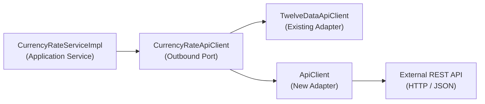

# Adding a New Currency Rate Provider to `spending.service`

This skill provides an authoritative, step-by-step procedure for adding an external foreign exchange rate data provider to `spending.service`. The project strictly adheres to **Hexagonal Architecture (Ports and Adapters)**, **Domain-Driven Design (DDD)**, and **Resilience4j** fault-tolerance patterns.

---

## 1. Architecture & Design Rules



* **Outbound Port:** `com.example.spending.service.application.port.out.CurrencyRateApiClient`
* **Domain Model:** `com.example.spending.service.domain.model.ExchangeRate`
* **Application Service:** `com.example.spending.service.application.service.impl.CurrencyRateServiceImpl`
* **Existing Reference Implementation:** `com.example.spending.service.infrastructure.adapter.out.client.twelvedata.TwelveDataApiClient`
* **Storage / Cache:** Rates are cached in the PostgreSQL table `exchange_rates` via `com.example.spending.service.domain.repository.ExchangeRateRepository`.
* **Precision Rule:** All currency amounts and rates must strictly use `BigDecimal`. Never use `float` or `double`.

---

## 2. Step-by-Step Implementation Guide

### Step 1: Create Configuration Properties

Create a configuration record under `com.example.spending.service.infrastructure.adapter.out.client.<provider>`:

**File:** `src/main/java/com/example/spending/service/infrastructure/adapter/out/client/<provider>/<Provider>Properties.java`

```java
package com.example.spending.service.infrastructure.adapter.out.client.<provider>;

import org.springframework.boot.context.properties.ConfigurationProperties;

import java.time.Duration;

@ConfigurationProperties(prefix = "app.currency.<provider>")
public record <Provider>Properties(
        String baseUrl,
        String apiKey,
        Duration connectTimeout,
        Duration readTimeout
) {
    public <Provider>Properties {
        if (baseUrl == null || baseUrl.isBlank()) {
            baseUrl = "https://api.<provider>.com";
        }
        if (apiKey == null || apiKey.isBlank()) {
            apiKey = "demo";
        }
        if (connectTimeout == null) {
            connectTimeout = Duration.ofSeconds(1);
        }
        if (readTimeout == null) {
            readTimeout = Duration.ofSeconds(2);
        }
    }
}
```

---

### Step 2: Configure Dedicated `RestClient` Bean

Create a configuration class to configure Spring's `RestClient` with timeout controls:

**File:** `src/main/java/com/example/spending/service/infrastructure/adapter/out/client/<provider>/<Provider>ClientConfig.java`

```java
package com.example.spending.service.infrastructure.adapter.out.client.<provider>;

import org.springframework.boot.context.properties.EnableConfigurationProperties;
import org.springframework.context.annotation.Bean;
import org.springframework.context.annotation.Configuration;
import org.springframework.http.client.SimpleClientHttpRequestFactory;
import org.springframework.web.client.RestClient;

@Configuration
@EnableConfigurationProperties(<Provider>Properties.class)
public class <Provider>ClientConfig {

    @Bean
    public RestClient <provider>RestClient(<Provider>Properties properties) {
        var factory = new SimpleClientHttpRequestFactory();
        factory.setConnectTimeout(properties.connectTimeout());
        factory.setReadTimeout(properties.readTimeout());

        return RestClient.builder()
                .baseUrl(properties.baseUrl())
                .requestFactory(factory)
                .build();
    }
}
```

---

### Step 3: Implement Provider Response DTO

Define immutable DTO record(s) matching the provider's JSON structure.

**File:** `src/main/java/com/example/spending/service/infrastructure/adapter/out/client/<provider>/dto/<Provider>ResponseDto.java`

Requirements:
1. Handle provider error messages or empty results gracefully.
2. Provide helper methods:
   - `effectiveCloseRate()`: returns close rate, or falls back to previous close rate if market is closed.
   - `previousClose()`: returns previous day close rate.

```java
package com.example.spending.service.infrastructure.adapter.out.client.<provider>.dto;

import com.fasterxml.jackson.annotation.JsonIgnoreProperties;
import com.fasterxml.jackson.annotation.JsonProperty;

import java.math.BigDecimal;

@JsonIgnoreProperties(ignoreUnknown = true)
public record <Provider>ResponseDto(
        @JsonProperty("symbol") String symbol,
        @JsonProperty("close") BigDecimal close,
        @JsonProperty("previous_close") BigDecimal previousClose,
        @JsonProperty("date") String date,
        @JsonProperty("status") String status,
        @JsonProperty("error") String error
) {
    public boolean isError() {
        return "error".equalsIgnoreCase(status) || error != null;
    }

    public BigDecimal effectiveCloseRate() {
        return close != null ? close : previousClose;
    }

    public boolean hasAnyRate() {
        return effectiveCloseRate() != null;
    }
}
```

---

### Step 4: Implement Outbound Adapter (`CurrencyRateApiClient`)

Create the adapter implementing `CurrencyRateApiClient` with Resilience4j circuit breaker and rate limiting:

**File:** `src/main/java/com/example/spending/service/infrastructure/adapter/out/client/<provider>/<Provider>ApiClient.java`

```java
package com.example.spending.service.infrastructure.adapter.out.client.<provider>;

import com.example.spending.service.application.port.out.CurrencyRateApiClient;
import com.example.spending.service.domain.model.ExchangeRate;
import com.example.spending.service.infrastructure.adapter.out.client.<provider>.dto.<Provider>ResponseDto;
import io.github.resilience4j.circuitbreaker.annotation.CircuitBreaker;
import io.github.resilience4j.ratelimiter.annotation.RateLimiter;
import lombok.RequiredArgsConstructor;
import lombok.extern.slf4j.Slf4j;
import org.springframework.boot.autoconfigure.condition.ConditionalOnProperty;
import org.springframework.stereotype.Component;
import org.springframework.web.client.RestClient;
import org.springframework.web.util.UriComponentsBuilder;

import java.time.LocalDate;
import java.time.ZoneOffset;
import java.util.Optional;

@Component
@ConditionalOnProperty(name = "app.currency.provider", havingValue = "<provider>")
@RequiredArgsConstructor
@Slf4j
public class <Provider>ApiClient implements CurrencyRateApiClient {

    private final RestClient <provider>RestClient;
    private final <Provider>Properties properties;

    @Override
    @CircuitBreaker(name = "<provider>", fallbackMethod = "fetchRateFallback")
    @RateLimiter(name = "<provider>", fallbackMethod = "fetchRateFallback")
    public Optional<ExchangeRate> fetchRate(String currencyPair, LocalDate date) {
        var uriBuilder = UriComponentsBuilder.fromPath("/query")
                .queryParam("symbol", currencyPair)
                .queryParam("apikey", properties.apiKey());

        if (date != null) {
            uriBuilder.queryParam("date", date.toString());
        }

        String uri = uriBuilder.build().toUriString();
        log.debug("Requesting exchange rate for {} from <Provider>: {}", currencyPair, uri);

        <Provider>ResponseDto response = <provider>RestClient.get()
                .uri(uri)
                .retrieve()
                .body(<Provider>ResponseDto.class);

        if (response == null || response.isError() || !response.hasAnyRate()) {
            log.warn("<Provider> returned no rate or error for {}: {}",
                    currencyPair, response != null ? response.error() : "null response");
            return Optional.empty();
        }

        LocalDate rateDate = date != null ? date : LocalDate.now(ZoneOffset.UTC);

        ExchangeRate exchangeRate = ExchangeRate.builder()
                .currencyPair(currencyPair)
                .rateDate(rateDate)
                .closeRate(response.effectiveCloseRate())
                .previousCloseRate(response.previousClose())
                .build();

        log.info("Successfully fetched exchange rate from <Provider> for {}: close={}, prevClose={}",
                currencyPair, exchangeRate.getCloseRate(), exchangeRate.getPreviousCloseRate());

        return Optional.of(exchangeRate);
    }

    public Optional<ExchangeRate> fetchRateFallback(String currencyPair, LocalDate date, Throwable ex) {
        log.warn("Resilience4j fallback triggered for <Provider> ({}, {}): {}",
                currencyPair, date, ex.getMessage());
        return Optional.empty();
    }
}
```

---

### Step 5: Configure Application Properties & Resilience4j

Add provider properties and resilience configuration to `src/main/resources/application.yaml`:

```yaml
app:
  currency:
    provider: ${CURRENCY_PROVIDER:twelvedata} # switchable: twelvedata, <provider>
    <provider>:
      base-url: ${PROVIDER_BASE_URL:https://api.<provider>.com}
      api-key: ${PROVIDER_API_KEY:demo}
      connect-timeout: 1s
      read-timeout: 2s

resilience4j:
  circuitbreaker:
    instances:
      <provider>:
        sliding-window-size: 10
        sliding-window-type: COUNT_BASED
        minimum-number-of-calls: 5
        failure-rate-threshold: 50
        wait-duration-in-open-state: 10s
        permitted-number-of-calls-in-half-open-state: 3
        automatic-transition-from-open-to-half-open-enabled: true
  ratelimiter:
    instances:
      <provider>:
        limit-for-period: 8
        limit-refresh-period: 1m
        timeout-duration: 500ms
```

---

### Step 6: Write Integration Tests with WireMock

Create integration tests inheriting from `BaseIntegrationTest` to verify HTTP contract, Resilience4j fallbacks, and weekend behavior:

**File:** `src/test/java/com/example/spending/service/infrastructure/adapter/out/client/<provider>/<Provider>ApiClientIntegrationTest.java`

```java
package com.example.spending.service.infrastructure.adapter.out.client.<provider>;

import com.example.spending.service.domain.model.ExchangeRate;
import com.example.spending.service.support.BaseIntegrationTest;
import org.junit.jupiter.api.DisplayName;
import org.junit.jupiter.api.Test;
import org.springframework.beans.factory.annotation.Autowired;
import org.springframework.test.context.DynamicPropertyRegistry;
import org.springframework.test.context.DynamicPropertySource;

import java.math.BigDecimal;
import java.time.LocalDate;
import java.util.Optional;

import static com.github.tomakehurst.wiremock.client.WireMock.*;
import static org.assertj.core.api.Assertions.assertThat;

class <Provider>ApiClientIntegrationTest extends BaseIntegrationTest {

    @Autowired
    private <Provider>ApiClient client;

    @DynamicPropertySource
    static void overrideProperties(DynamicPropertyRegistry registry) {
        registry.add("app.currency.provider", () -> "<provider>");
        registry.add("app.currency.<provider>.base-url", wireMock::baseUrl);
        registry.add("app.currency.<provider>.api-key", () -> "test-key");
    }

    @Test
    @DisplayName("Should parse valid JSON quote into ExchangeRate domain model")
    void shouldFetchRateSuccessfully() {
        wireMock.stubFor(get(urlPathEqualTo("/query"))
                .withQueryParam("symbol", equalTo("RUB/USD"))
                .willReturn(aResponse()
                        .withHeader("Content-Type", "application/json")
                        .withBody("""
                                {
                                  "symbol": "RUB/USD",
                                  "date": "2022-01-15",
                                  "close": 0.0130,
                                  "previous_close": 0.0128,
                                  "status": "ok"
                                }
                                """)));

        Optional<ExchangeRate> rate = client.fetchRate("RUB/USD", LocalDate.of(2022, 1, 15));

        assertThat(rate).isPresent();
        assertThat(rate.get().getCloseRate()).isEqualByComparingTo("0.0130");
        assertThat(rate.get().getPreviousCloseRate()).isEqualByComparingTo("0.0128");
    }

    @Test
    @DisplayName("Should return empty optional when external API returns 500 error (fallback triggered)")
    void shouldFallbackOnApiFailure() {
        wireMock.stubFor(get(urlPathEqualTo("/query"))
                .withQueryParam("symbol", equalTo("RUB/USD"))
                .willReturn(aResponse().withStatus(500)));

        Optional<ExchangeRate> rate = client.fetchRate("RUB/USD", LocalDate.of(2022, 1, 15));

        assertThat(rate).isEmpty();
    }
}
```

---

## 3. Verification & Checklist

Before submitting code, execute:

```bash
# 1. Run new provider integration test
mvn test -Dtest=<Provider>ApiClientIntegrationTest

# 2. Run full test suite to guarantee zero regression
mvn test
```

### Self-Check Checklist:
- [ ] Interface `CurrencyRateApiClient` is properly implemented.
- [ ] Connect timeout (1s) and read timeout (2s) are strictly configured.
- [ ] Resilience4j `@CircuitBreaker` and `@RateLimiter` configured with matching fallback signature.
- [ ] `BigDecimal` used for all monetary values.
- [ ] Weekend logic: if `close` is null, `effectiveCloseRate()` returns `previousClose`.
- [ ] Integration test passes with WireMock.
