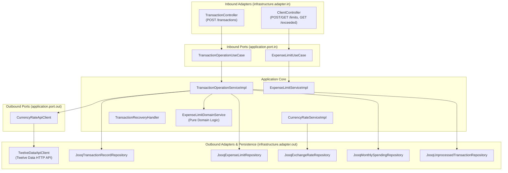

# AGENTS.md — Developer and AI Agent Guidelines for `spending.service`

This document defines core architectural patterns, coding conventions, build instructions, and testing protocols for human developers and autonomous AI agents (Antigravity, Codex, Cursor, Claude Code, Copilot) working on this codebase.

---

## 1. Project Overview & Tech Stack

* **Language:** Java 21 LTS (Records, Sealed Interfaces, Pattern Matching, Virtual Threads)
* **Framework:** Spring Boot 4.1.1 (Spring Web MVC with virtual threads enabled, RFC 9457 `ProblemDetail`)
* **Persistence & SQL:** jOOQ 3.19.16 (type-safe SQL queries, explicit transaction management)
* **Database:** PostgreSQL 15+
* **Migrations:** Liquibase 4.29.2 (YAML change-sets, schema-first design)
* **Fault Tolerance:** Resilience4j 2.2.0 (`@CircuitBreaker`, `@RateLimiter`)
* **Testing:** JUnit 5, AssertJ, Mockito, Testcontainers (PostgreSQL via `@ServiceConnection`), WireMock 3.13.0
* **API Documentation:** SpringDoc OpenAPI 2.8.5 (`/swagger-ui.html`, `/v3/api-docs`)

---

## 2. Architectural Blueprint: Hexagonal / Ports & Adapters



### Package Structure
- `com.example.spending.service.domain`:
  - `model`: Immutable Domain entities and Value Objects (`AccountNumber`, `CurrencyCode`, `ExpenseCategory`, `ExpenseLimit`, `TransactionRecord`, `ExchangeRate`, `UnprocessedTransaction`).
  - `repository`: Outbound repository interfaces representing persistent aggregate boundaries.
  - `service`: Pure domain services without framework dependencies (`ExpenseLimitDomainService`, `CurrencyConversionDomainService`).
  - `util`: Standard utility functions (`DateTimeUtils`).
- `com.example.spending.service.application`:
  - `port.in`: Inbound interfaces for use cases (`TransactionOperationUseCase`, `ExpenseLimitUseCase`).
  - `port.out`: Outbound interfaces for external system integrations (`CurrencyRateApiClient`).
  - `service.impl`: Application service implementations coordinating domain logic, persistence, and transactions.
- `com.example.spending.service.infrastructure`:
  - `adapter.in.rest`: REST controllers, request/response DTOs, global exception handling (`GlobalExceptionHandler`).
  - `adapter.out.persistence`: jOOQ repositories, record mappers, and custom jOOQ SQL queries.
  - `adapter.out.client`: External HTTP client adapters with Resilience4j circuit breakers and rate limiters.
  - `worker`: Background scheduled tasks (`UnprocessedTransactionWorker`, `CurrencyRateSyncWorker`).
  - `config`: Spring `@Configuration` beans (`JooqConfig`, `SchedulingConfig`, `OpenApiConfig`).

---

## 3. Key Conventions & Business Invariants

1. **Monetary Precision:** Always use `BigDecimal` for currency values, rates, and limits. Never use `float` or `double`.
2. **Timezone Normalization:** All monthly limits and spending aggregations are strictly computed in **UTC** (`ZoneOffset.UTC`). All incoming dates (`OffsetDateTime`) are converted to UTC for month boundary calculations (`startOfMonth`, `startOfNextMonth`).
3. **Monthly Limit Invariants:**
   - Limits are immutable once created. A client can only add a *new* limit with the current timestamp (`Clock`). Existing limit records must never be updated or deleted.
   - When transitioning into a new calendar month (e.g., from Jan 31 to Feb 1), the active limit configured in previous months remains active, but accumulated monthly spending resets to zero.
   - If no explicit limit was ever configured for an account/category, the system applies an implicit default limit of **1000.00 USD**.
4. **Concurrency & Thread Safety:**
   - Concurrent parallel requests for the same account must acquire a row-level pessimistic write lock (`SELECT ... FOR UPDATE` via jOOQ) on `ACCOUNT_MONTHLY_SPENDING`.
   - Parallel transactions must never "see" or double-spend the same remaining limit balance.
5. **Zero Data Loss & DLQ:**
   - If external exchange rates cannot be obtained and are missing from DB cache, the transaction is **never dropped**. It is persisted to `unprocessed_transactions` with status `PENDING`.
   - The REST client receives HTTP `503 Service Unavailable` with `ProblemDetail` (RFC 9457).
   - Background worker `UnprocessedTransactionWorker` retries and recovers parked transactions once rates become available.
6. **SQL & jOOQ Conventions:**
   - Database table and column names in PostgreSQL are lowercase snake_case.
   - `JooqConfig` configures `RenderNameCase.LOWER` and `RenderQuotedNames.EXPLICIT_DEFAULT_UNQUOTED`. Do not hardcode quoted uppercase identifiers in jOOQ queries.

---

## 4. Build, Run, and Test Commands

### Prerequisites
* Java 21 JDK
* Docker (for Testcontainers & Docker Compose)
* Maven 3.9+ (or `./mvnw`)

### Build & Run
```bash
# Compile and generate jOOQ classes
mvn clean compile

# Run application locally
mvn spring-boot:run

# Run with Docker Compose (PostgreSQL + App)
docker compose up --build
```

### Testing Commands
```bash
# Run ALL unit and integration tests (63 tests)
mvn test

# Run ONLY integration tests
mvn test -Dtest=*IntegrationTest

# Run specific E2E key scenario test (Requirement 6)
mvn test -Dtest=KeyScenarioE2EIntegrationTest

# Run Concurrency test
mvn test -Dtest=ConcurrencyIntegrationTest
```

---

## 5. Working with AI Customizations in This Repository

* **Agent Skills:** Located in [`.agents/skills/`](file:///.agents/skills/).
  - [`.agents/skills/add-currency-provider/SKILL.md`](file:///.agents/skills/add-currency-provider/SKILL.md): Use this skill whenever implementing a new forex exchange rate provider.
* **MCP Server Configuration:**
  - [`.agents/mcp_config.json`](file:///.agents/mcp_config.json) & [`.mcp.json`](file:///.mcp.json): Connects Antigravity CLI and standard MCP clients to local PostgreSQL.
  - Credentials are dynamically sourced from `${POSTGRES_USER}`, `${POSTGRES_PASSWORD}`, `${POSTGRES_HOST}`, `${POSTGRES_PORT}`, and `${POSTGRES_DB}`. **Never commit secrets to git.**
