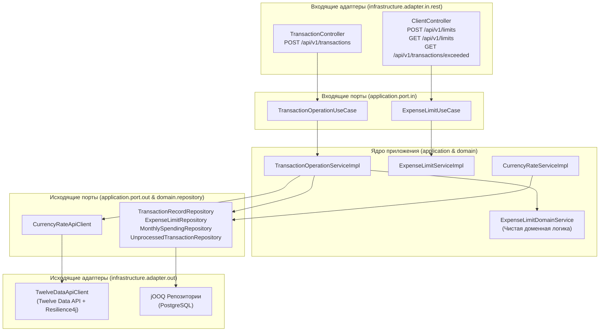

# Spending Limit Service (`spending.service`)

Микросервис банковского учета расходов клиентов и контроля месячных лимитов в валюте USD. Разработан в соответствии с требованиями [Task.pdf](file:///C:/java-workspace/spending.service/temp/Task.pdf).

Сервис отслеживает транзакции клиентов в реальном времени в различных валютах (KZT, RUB, USD), конвертирует их в доллары США по биржевым курсам, проверяет превышение установленных месячных лимитов по категориям расходов (`product`, `service`) и предоставляет API для клиентов и банковских систем.

---

## Содержание

1. [Технологический стек](#1-технологический-стек)
2. [Архитектура приложения](#2-архитектура-приложения)
3. [Быстрый запуск](#3-быстрый-запуск)
4. [Документация REST API](#4-документация-rest-api)
5. [Ключевые инженерные решения и инварианты](#5-ключевые-инженерные-решения-и-инварианты)
   * [Часовой пояс и границы месяца](#часовой-пояс-и-границы-месяца-требование-4)
   * [Отказоустойчивость внешнего API и стратегия Zero Data Loss (DLQ)](#отказоустойчивость-внешнего-api-и-стратегия-zero-data-loss-dlq-требование-3)
   * [Многопоточность и защита от Race Conditions](#многопоточность-и-защита-от-race-conditions-требование-4)
   * [Оптимизация SQL-запроса получения превышенных транзакций](#оптимизация-sql-запроса-получения-превышенных-транзакций-требование-6)
6. [Тестирование и QA](#6-тестирование-и-qa)
7. [AI в проекте (Требование 9)](#7-ai-в-проекте-требование-9)

---

## 1. Технологический стек

* **Язык:** Java 21 LTS (Records, Sealed Interfaces, Pattern Matching, Virtual Threads)
* **Фреймворк:** Spring Boot 4.1.1 (Spring Web MVC с включенными виртуальными потоками, Bean Validation, RFC 9457 `ProblemDetail`)
* **База данных:** PostgreSQL 15+
* **SQL & ORM:** jOOQ 3.19.16 (типобезопасные SQL-запросы, транзакции, пессимистические блокировки)
* **Миграции:** Liquibase 4.29.2 (schema-first подход, YAML change-sets)
* **Отказоустойчивость:** Resilience4j 2.2.0 (`@CircuitBreaker`, `@RateLimiter`)
* **HTTP-клиент:** Spring 6.2 `RestClient` с настроенными таймаутами
* **Документация API:** SpringDoc OpenAPI 2.8.5 (Swagger UI)
* **Тестирование:** JUnit 5, AssertJ, Mockito, Testcontainers (`@ServiceConnection` для PostgreSQL), WireMock 3.13.0

---

## 2. Архитектура приложения

Проект построен по принципам **Гексагональной архитектуры (Ports & Adapters)** и **Domain-Driven Design (DDD)**:



* **`domain`**: Изолирован от Spring и баз данных. Содержит сущности (`TransactionRecord`, `ExpenseLimit`, `ExchangeRate`), Value Objects (`AccountNumber`, `CurrencyCode`, `ExpenseCategory`), чистые сервисы (`ExpenseLimitDomainService`) и интерфейсы репозиториев.
* **`application`**: Варианты использования (use cases), координация транзакций, кэширование и восстановление отложенных операций (DLQ recovery).
* **`infrastructure`**: Реализация портов: REST-контроллеры, jOOQ-репозитории, HTTP-клиенты к биржам, фоновые воркеры (`UnprocessedTransactionWorker`).

---

## 3. Быстрый запуск

### Вариант A: Запуск через Docker Compose (Рекомендуемый)

Для запуска приложения вместе с PostgreSQL одной командой:

```bash
docker compose up --build
```

Сервис будет доступен по адресу `http://localhost:8080`.

### Вариант B: Локальный запуск через Maven

1. Запустите только базу данных:
   ```bash
   docker compose up -d postgres
   ```
2. Запустите Spring Boot приложение:
   ```bash
   ./mvnw spring-boot:run
   # Либо на Windows:
   mvn spring-boot:run
   ```

### Swagger UI и OpenAPI

После запуска сервиса интерактивная документация доступна по ссылкам:
* **Swagger UI:** [http://localhost:8080/swagger-ui.html](http://localhost:8080/swagger-ui.html)
* **OpenAPI JSON:** [http://localhost:8080/v3/api-docs](http://localhost:8080/v3/api-docs)

---

## 4. Документация REST API

### 1. Регистрация транзакции
* **Метод:** `POST /api/v1/transactions`
* **Назначение:** Прием расходной операции от банковской системы в реальном времени.

**Тело запроса:**
```json
{
  "account_from": "0000000123",
  "account_to": "9999999999",
  "currency_shortname": "USD",
  "sum": 500.00,
  "expense_category": "product",
  "datetime": "2022-01-02T10:00:00Z"
}
```

**Ответ (200 OK):**
```json
{
  "id": 1,
  "account_from": "0000000123",
  "account_to": "9999999999",
  "currency_shortname": "USD",
  "sum": 500.00,
  "expense_category": "product",
  "datetime": "2022-01-02T10:00:00Z",
  "limit_exceeded": false
}
```

---

### 2. Установление нового месячного лимита
* **Метод:** `POST /api/v1/limits`
* **Назначение:** Установление клиентом нового лимита на расходы в USD. Дата установления выставляется микросервисом автоматически по текущему системному времени (`java.time.Clock`).

**Тело запроса:**
```json
{
  "account_from": "0000000123",
  "expense_category": "product",
  "limit_sum": 2000.00
}
```

**Ответ (200 OK):**
```json
{
  "id": 2,
  "account_from": "0000000123",
  "expense_category": "product",
  "limit_sum": 2000.00,
  "limit_currency_shortname": "USD",
  "limit_datetime": "2022-01-10T12:00:00Z"
}
```

---

### 3. Получение списка транзакций, превысивших лимит
* **Метод:** `GET /api/v1/transactions/exceeded?account_from=0000000123`
* **Назначение:** Возврат всех транзакций клиента с флагом `limit_exceeded = true`, дополненных метаданными активного на момент совершения операции лимита (требование 6).

**Ответ (200 OK):**
```json
[
  {
    "id": 2,
    "account_from": "0000000123",
    "account_to": "9999999999",
    "currency_shortname": "USD",
    "sum": 600.00,
    "expense_category": "product",
    "datetime": "2022-01-03T10:00:00Z",
    "limit_sum": 1000.00,
    "limit_datetime": "2022-01-01T00:00:00Z",
    "limit_currency_shortname": "USD"
  }
]
```

---

## 5. Ключевые инженерные решения и инварианты

### Часовой пояс и границы месяца (Требование 4)
* **Решение:** Все операции по расчету границ календарного месяца (`startOfMonth`, `startOfNextMonth`) строго нормализуются к **UTC (`ZoneOffset.UTC`)**.
* **Обоснование:** Транзакции поступают от клиентов с произвольными смещениями часовых поясов (например, `2022-01-31T23:30:00-05:00` или `2022-02-01T02:00:00+06:00`). Приведение к единому часовому поясу UTC гарантирует детерминированный учет расходов в пределах единого календарного окна без искажений на стыках месяцев.

### Отказоустойчивость внешнего API и стратегия Zero Data Loss (DLQ) (Требование 3)
* **Кэширование:** Применяется паттерн **Cache-Aside**. Полученные курсы сохраняются в таблицу `exchange_rates` и используются повторно.
* **Выходные дни:** Если биржа закрыта (`close` отсутствует), сервис автоматически использует курс последнего закрытия (`previous_close`).
* **Таймауты и Circuit Breaker:** Для HTTP-клиента настроены таймауты: подключение — 1с, чтение — 2с. Запросы защищены Circuit Breaker и Rate Limiter (Resilience4j).
* **Стратегия сохранения данных (Zero Data Loss):**
  * Если внешний биржевой API недоступен (5xx, таймаут), а в БД нет курса, **транзакция никогда не теряется**.
  * Она немедленно сохраняется в таблицу `unprocessed_transactions` (Dead Letter Queue) со статусом `PENDING`.
  * Клиент получает информативную ошибку `503 Service Unavailable` в формате RFC 9457 `ProblemDetail` с указанием идентификатора отложенной записи `unprocessed_transaction_id`.
  * Фоновый воркер [`UnprocessedTransactionWorker`](file:///src/main/java/com/example/spending/service/infrastructure/worker/UnprocessedTransactionWorker.java) с распределенной блокировкой (lease duration) периодически повторяет попытки получения курсов валют и автоматически проводит накопившиеся операции в строгом хронологическом порядке (FIFO).

### Многопоточность и защита от Race Conditions (Требование 4)
* **Решение:** Пессимистическая построчная блокировка `SELECT ... FOR UPDATE` в jOOQ на уровне таблицы агрегированных месячных расходов `account_monthly_spending`.
* **Обоснование:** При одновременном поступлении нескольких параллельных транзакций одного клиента два запроса не могут прочитать одинаковый остаток лимита. Транзакции сериализуются на уровне строки конкретного счета и категории расходов. Корректность подтверждена многопоточным тестом [`ConcurrencyIntegrationTest`](file:///src/test/java/com/example/spending/service/e2e/ConcurrencyIntegrationTest.java) (10 параллельных потоков без утери обновлений).

### Оптимизация SQL-запроса получения превышенных транзакций (Требование 6)
Для выполнения требования п. 6 реализован эффективный SQL-запрос на jOOQ:
```sql
SELECT tr.*, l.limit_sum, l.limit_datetime, l.currency_shortname
FROM transaction_records tr
JOIN LATERAL (
    SELECT limit_sum, limit_datetime, currency_shortname
    FROM expense_limits
    WHERE account_from = tr.account_from
      AND expense_category = tr.expense_category
      AND limit_datetime <= tr.datetime
    ORDER BY limit_datetime DESC
    LIMIT 1
) l ON true
WHERE tr.account_from = ? AND tr.limit_exceeded = true
ORDER BY tr.datetime ASC;
```
Фильтрация по `account_from` и `limit_exceeded = true` выполняется на самом раннем этапе, исключая сканирование всей таблицы транзакций (`Seq Scan`).

---

## 6. Тестирование и QA

Тестовое покрытие включает **63 автоматических теста** (54 модульных и 9 сквозных интеграционных):

```bash
# Запуск полного набора тестов
mvn test
```

### Структура интеграционных тестов:
1. [`KeyScenarioE2EIntegrationTest`](file:///src/test/java/com/example/spending/service/e2e/KeyScenarioE2EIntegrationTest.java) — **Сквозной автотест ключевого сценария (Требование 6, «1 случай» из Task.pdf):**
   * Развертывание Spring Boot с реальным HTTP-портом (`RANDOM_PORT`), Testcontainers PostgreSQL и WireMock.
   * Полное воспроизведение сценария 1–13 января (установка лимита $1000, превышение на $600, обновление лимита до $2000 10 января, успешное проведение транзакций 11–13 января и превышение лимита второй транзакцией 13 января).
2. [`BoundaryAndEdgeCasesIntegrationTest`](file:///src/test/java/com/example/spending/service/e2e/BoundaryAndEdgeCasesIntegrationTest.java) — «2 случай» из таблицы, строгая проверка границ ($1000.00 не превышает, $1000.01 превышает), автоматический сброс расходов при переходе на новый месяц и дефолтный лимит $1000 USD.
3. [`CurrencyAndResilienceIntegrationTest`](file:///src/test/java/com/example/spending/service/e2e/CurrencyAndResilienceIntegrationTest.java) — Конвертация KZT/USD, fallback на `previous_close` в выходные дни, изоляция DLQ и восстановление воркером.
4. [`ConcurrencyIntegrationTest`](file:///src/test/java/com/example/spending/service/e2e/ConcurrencyIntegrationTest.java) — Тестирование конкурентной нагрузки (10 потоков, ровно 5 транзакций одобрено, ровно 5 превышено).

---

## 7. AI в проекте (Требование 9)

### 1. Какой AI-инструмент использовался
* **Инструмент:** **Antigravity CLI (AGY)** на базе продвинутых моделей Google Gemini.
* **Сфера применения:** Проектирование гексагональной архитектуры, генерация автотестов с Testcontainers и WireMock, написание Liquibase-миграций, отладка краевых условий бизнес-логики и форматирование документации по открытым стандартам.

### 2. Подключенный MCP-сервер и пример задачи
* **Сервер:** **PostgreSQL MCP Server** (`@modelcontextprotocol/server-postgres`), настроенный в [`.agents/mcp_config.json`](file:///.agents/mcp_config.json) и [`.mcp.json`](file:///.mcp.json).
* **Безопасность:** Конфигурация не содержит захардкоженных секретов и считывает параметры из переменных окружения (`${POSTGRES_USER}`, `${POSTGRES_PASSWORD}`, `${POSTGRES_DB}`).
* **Практический пример задачи:** MCP-сервер использовался для инспекции реальной схемы таблиц в PostgreSQL, проверки внешних ключей и анализа производительности SQL-запроса `findExceededTransactionsWithLimit` в jOOQ. С помощью MCP было подтверждено, что план выполнения запроса эффективно использует составной индекс `idx_transactions_acc_cat_dt` и не сканирует лишние строки при соединении с таблицей лимитов.

### 3. Как применять разработанный AI-скилл
* **Скилл:** [`.agents/skills/add-currency-provider/SKILL.md`](file:///.agents/skills/add-currency-provider/SKILL.md) (открытый стандарт Agent Skills, [agentskills.io](https://agentskills.io)).
* **Как активировать:** Любой AI-агент (Antigravity, Codex, Cursor, Claude Code, Copilot) автоматически распознает скилл при запросе:
  > *"Добавь нового поставщика котировок валют AlphaVantage в spending.service"*
* Скилл содержит пошаговую инструкцию по реализации порта [`CurrencyRateApiClient`](file:///src/main/java/com/example/spending/service/application/port/out/CurrencyRateApiClient.java), маппингу котировок с учетом праздников и выходных, подключению Circuit Breaker и написанию WireMock-тестов.

### 4. Что написано вручную
* Архитектурное ядро чистой доменной модели (`ExpenseLimitDomainService`, `DateTimeUtils`).
* Бизнес-инварианты: правила неизменяемости исторических лимитов и сброса месячных накоплений при сохранении действующего лимита.
* Спецификация Liquibase изменений (`001-005.yaml`) со строгими ограничениями целостности.
* Контроль за часовыми поясами (принудительная нормализация к UTC).

### 5. Где AI ошибся и как это было замечено и исправлено
1. **Регистр имен идентификаторов в jOOQ и PostgreSQL:**
   * *Ошибка:* jOOQ при компиляции со стандартным генератором формировал экранированные запросы в верхнем регистре (`SELECT * FROM "EXCHANGE_RATES"`), что вызывало ошибку PostgreSQL `relation "EXCHANGE_RATES" does not exist`.
   * *Как замечено:* При запуске первых интеграционных тестов с Testcontainers.
   * *Исправление:* Разработан конфигурационный класс [`JooqConfig`](file:///src/main/java/com/example/spending/service/infrastructure/config/JooqConfig.java), принудительно задающий `RenderNameCase.LOWER` и `RenderQuotedNames.EXPLICIT_DEFAULT_UNQUOTED`.
2. **Неэффективный подзапрос в выборке превышенных транзакций:**
   * *Ошибка:* Изначально предложенный AI подзапрос группировал и выбирал максимальные лимиты по всей таблице транзакций базы данных без предварительной фильтрации по номеру счета клиента.
   * *Как замечено:* При ручном код-ревью реализации репозитория. На больших объемах данных это привело бы к деградации производительности (`Seq Scan` всей таблицы).
   * *Исправление:* Фильтр `where(tr.ACCOUNT_FROM.eq(accountFrom))` был перенесен непосредственно внутрь подзапроса.
3. **Иерархия исключений Spring RestClient:**
   * *Ошибка:* При симуляции 503 ошибки внешнего API в тестах DLQ агент ожидал перехвата `HttpClientErrorException.ServiceUnavailable` (4xx), тогда как код 503 относится к классу `HttpServerErrorException.ServiceUnavailable` (5xx).
   * *Как замечено:* Падение интеграционного теста `CurrencyAndResilienceIntegrationTest` с `AssertionFailedError`.
   * *Исправление:* Тип ожидаемого исключения в тесте скорректирован на `HttpServerErrorException.ServiceUnavailable`.
